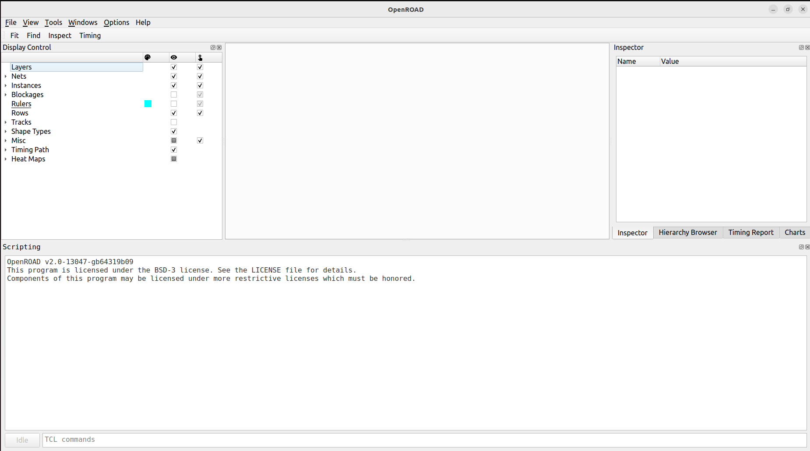
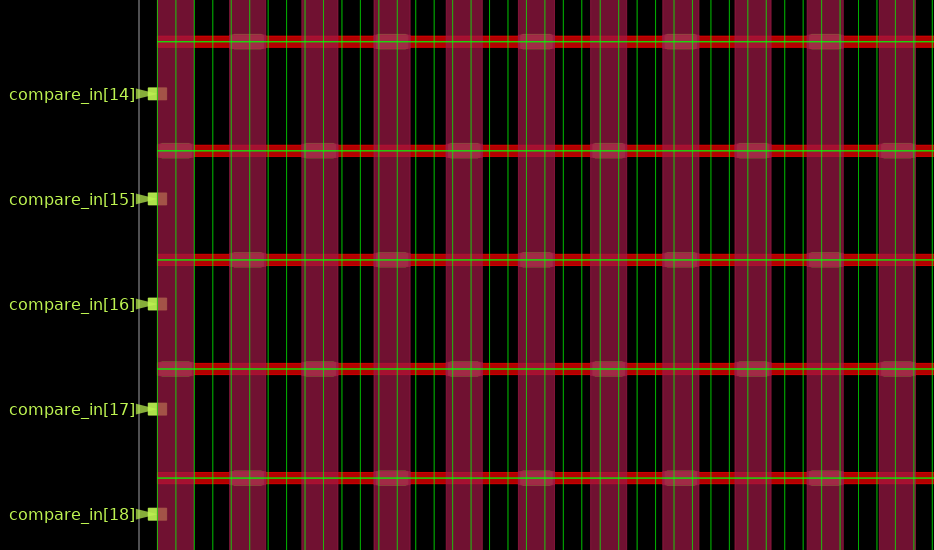
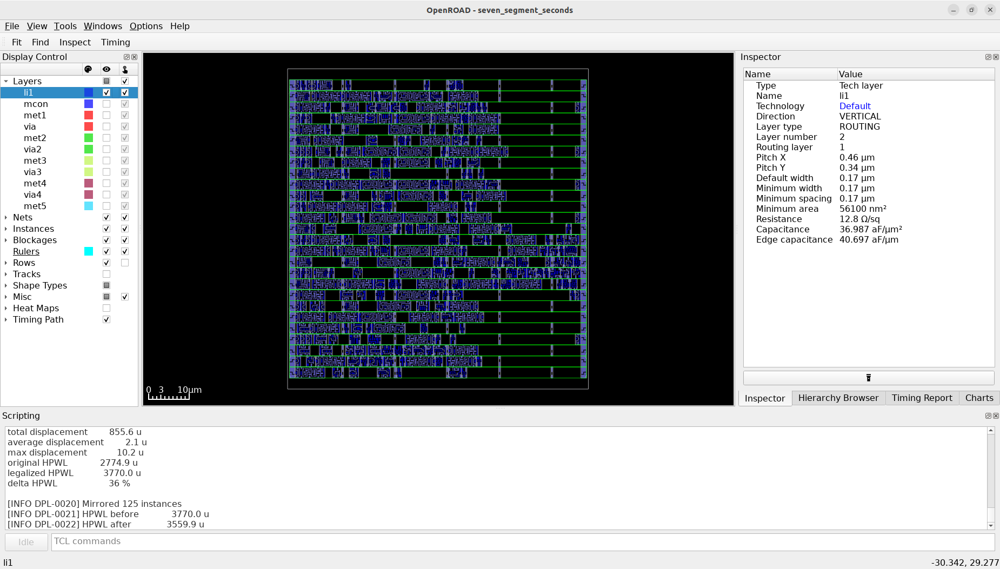
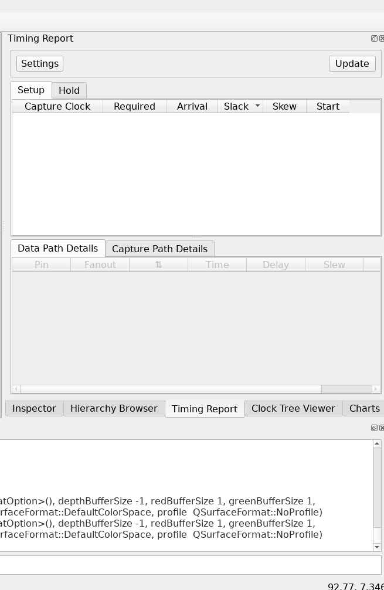
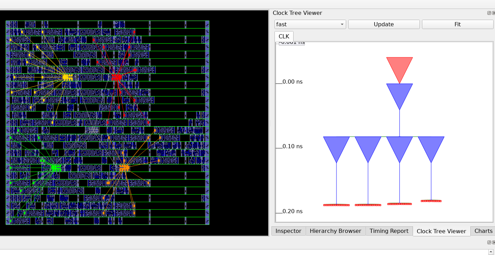
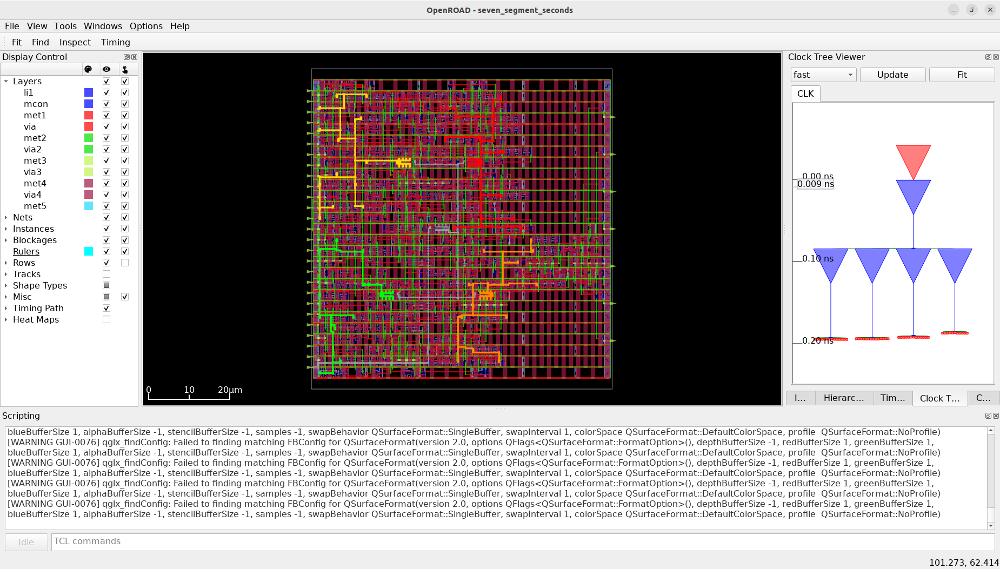
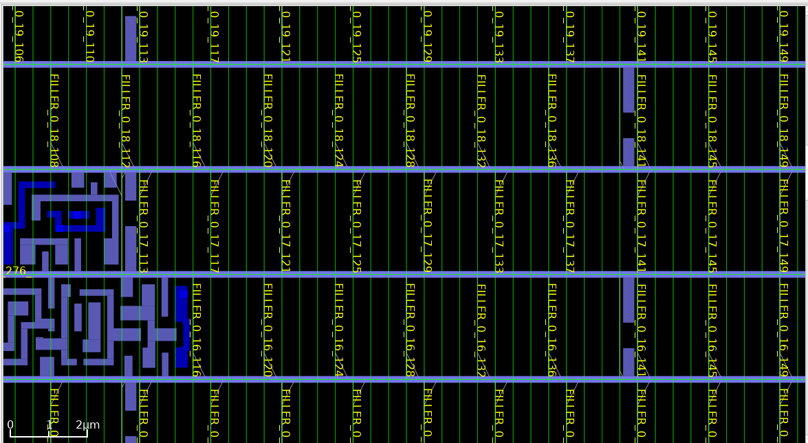
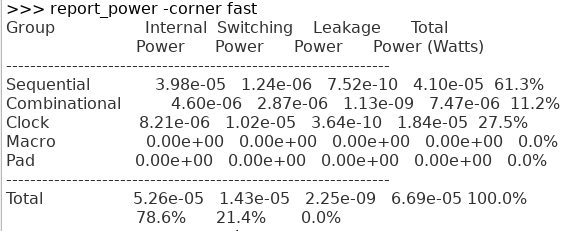
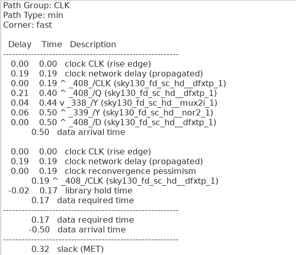

# Разработка топологии

## Запуск OpenROAD

1. В терминале перейдите в папку work/layout с помощью следующей команды (данная команда также создаст нужную папку если она отстутствует):

```bash
mkdir -p ../layout && cd ../layout
```

и запустите команду:

```bash
openroad -gui -log log.txt
```

Данная команда запустит САПР OpenRoad в режиме графического интерфейса, а также создаст файл log.txt куда будут записываться результаты выполнения команд.

2. Ознакомимся с интерфейсом OpenRoad:



На рисунке ниже обозначены основные элементы графического интерфейса САПР:


Нижняя часть графического интерфейса, по сути, представляет собой терминал, в котором и будет происходить основная работа над топологией блока

## Загрузка проекта в OpenROAD

3. В командной строке OpenROAD запустите команду:

```tcl
source ../../scr/layout/load_design.tcl
```

Произойдет исполнение скрипта load_design.tcl, имеющего следующее содержание:

```tcl
############################################################################################
#set units
set_cmd_units -time ns -capacitance pF -current mA -voltage V -resistance kOhm -distance um
############################################################################################

############################################################################################
#Read LEF files
read_lef ../../lefs/sky130.tlef ; # Techlef

read_lef ../../lefs/sky130_fd_sc_hd.lef ; # load all cell lefs
############################################################################################

############################################################################################
# Define corners and read corresponding LIB files
define_corners fast typical slow

read_liberty -corner fast    ../../lib/sky130_fd_sc_hd__ff_n40C_1v95.lib
read_liberty -corner typical ../../lib/sky130_fd_sc_hd__tt_025C_1v80.lib
read_liberty -corner slow    ../../lib/sky130_fd_sc_hd__ss_100C_1v40.lib
############################################################################################

############################################################################################
# Read the netlist
read_verilog ../syn/segment_seconds_netlist.v
link_design seven_segment_seconds
############################################################################################

############################################################################################
# Read SDC file
read_sdc ../../scr/sdc/const.sdc
############################################################################################
```

Данный скрипт задает некоторые начальные настройки, а затем последовательно загружает LEF  и LIB файлы, полученный после логического синтеза нетлист, а также SDC файл. Несколько LIB файлов позволят выполнить статический временной анализ с учетом PVT вариаций.

**Разработка floorplan**

**Установка размеров блока**

4. Сверните OpenROAD, перейдите в директорию vlsi_be_labs/scr/layout (без использования текущей командной строки) и откройте файл set_fp.tcl. В начале скрипта необходимо задать значения переменных, определяющих размеры ядра блока:

```tcl
###########################################
#set the block size
set X_size xxx
set Y_size yyy
###########################################
```

5. Вместо xxx и yyy введите размеры ядра блока, рассчитанные в конце раздела [«Логический синтез»](syn.md) и сохраните файл.

6. Вернитесь в OpenROAD и выполните команду:

```tcl
source ../../scr/layout/set_fp.tcl
```

Данная команда создаст фрейм блока и создаст ряды для дальнейшего размещения ячеек в соответствии с технологическим файлом.

В левой области контроля отображения элементов топологии (см.рис. выше) поставьте галочку у пункта Rows, тем самым включив отображение рядов стандартных ячеек.
В результате вы должны увидеть на экране фрейм блока с отображаемыми зеленым цветом рядами для размещения стандартных ячеек:

![][def]


[def]: images/rows.png

**Размещение пинов ввода-вывода**

7. Запустите скрипт размещения пинов, выполнив в терминал OpenROAD команду:

```tcl
source ../../scr/layout/pins_placement.tcl
```

В случае, если вы ознакамливались с [памяткой по TCL](basics.md), рекомендуем предварительно просмотреть содержание соответствующего скрипта.
Скрипт равномерно распределит входные пины по левой стороне блока, а выходные по правой стороне. Таким образом будет обеспечиваться более равномерное размещение стандартных ячеек при дальнейшем размещении.
На рисунке ниже приведен результат выполнения скрипта.

![][pins]

[pins]: images/pins.png

Если после выполнения скрипта пины не отобразились, немного приблизьте блок. Для этого зажмите клавишу Ctrl на клавиатуре и приближайте/удаляйте колесиком мышки.  Чтобы быстро вернуться к просмотру всего блока можно нажать клавишу f.


**Построение сетки земли-питания**

В технологии Skywater доступно 5 слоев металлизации. Мы проектируем блок, который может быть интегрирован в более крупную схему, поэтому исключим использование верхнего пятого слоя, так как в нем может выполняться включение блока в сеть питания кристалла на верхнем уровне. В силу небольших размеров блока ограничим сетку четвертым и первым слоем, в котором происходит непосредственно подключение стандартных ячеек к системе питания.

8. Запустите скрипт генерации сетки земли-питания, выполнив в терминале OpenROAD команду:

```tcl
source ../../scr/layout/pg_net.tcl
```

Содержание данного файла представлено ниже:

```tcl
#######################################################################
#Make connections
add_global_connection -net VDD -pin_pattern "vdd" -power
add_global_connection -net VSS -pin_pattern "gnd" -ground

global_connect

set_voltage_domain -name Core -power VDD -ground VSS
define_pdn_grid -name Core -voltage_domain Core
#######################################################################
#Add stripe
add_pdn_stripe -layer met4 -width 0.9 -offset 0.45 -pitch 3.6 -grid Core
add_pdn_stripe -layer met1 -width 0.28 -followpins -grid Core

add_pdn_connect -layers {met1 met4} -grid Core
#######################################################################
#Actual creation of PG grid
pdngen
#######################################################################
```

Первый блок команд создает глобальные соединения проекта, т.е. сопоставляет пины земли-питания элементов с сеткой земли-питания.
Второй блок определяет параметры будущей сетки с помощью команды `add_pdn_stripe`. Наконец, команда `pdngen` выполняет построение сетки земли-питания.

**Дополнительное задание 3**

Перейдите в [документацию OpenROAD](https://openroad.readthedocs.io/en/latest/main/src/pdn/README.html) и выясните назначение параметров `-offset` и `-pitch` команды `add_pdn_stripe`.

**Дополнительное задание 4**

Откройте TechLEF файл и просмотрите информацию о ширине слоя для каждого из слоев. Соотнесите эту информацию с информацией из приведенного выше скрипта.

9. Приблизьте произвольную часть блока с построенной сеткой:



Первый слой имеет горизонтальную ориентацию, а четвертый - вертикальную. Каждый слой металлизации имеет приоритетную ориентацию, указанную в TechLEF, в соответствии с которой САПР выбирает направление.

10. В левой части интерфейса OpenROAD находится панель контроля отображения слоев. Галочка напротив слоя означает, что он отображается. Убирая галочки, просмотрите несколько слоев. Обратите внимание на via (via, via2, via3 …) - переходные слои, с помощью которых соединяются слои металлизации.

**Размещение физических ячеек**

Физические ячейки необходимы для выполнения определенных технологических требований, обеспечения надежности. В работе мы будем использовать следующие типы физических ячеек:

- Well-tap ячейки - обеспечивают подключение p-подложки к земле и n-кармана к питанию для предотвращения эффекта защелки. Well-tap размещаются по площади кристалла в шахматном порядке с заданным интервалом. В данном проекте интервал составляет 13 мкм;
- End-cap ячейки - размещаются в конце рядов стандартных ячеек, так как из-за определенных технологических факторов они не должны завершаться логическими ячейками;
- Filler ячейки - устанавливаются в участки кристалла, не занятые логическими ячейками или макроблоками, т.е. заполняют свободное место на кристалле для сохранения непрерывности областей легирования и шин питания в нижнем слое металлизации. Некоторые ячейки типа filler также содержат емкость для фильтрации помех в цепях земли и питания.

11. Filler ячейки размещаются на последнем этапе разработки топологии. Для запуска размещения Well-tap и End-cap ячеек запустите в OpenROAD команду:

```tcl
source ../../scr/layout/taps.tcl
```

Данный скрипт расставит нужные ячейки, а также сохранит DEF файл проекта `fp.def`, так как на данном этапе будет завершена разработка floorplan.

12. Оцените, как изменился блок после выполнения скрипта. Для лучшей видимости добавленных ячеек отключите видимость некоторых слоев металлизации.

## Размещение стандартных ячеек

13. Для того, чтобы запустить размещение стандартных ячеек, выполните команду:

```tcl
source ../../scr/layout/place.tcl
```

Наиболее важные команды из этого скрипта:

```tcl
global_placement -routability_driven ; # глобальное "первоначальное" размещение
detailed_placement ; # детальное размещение с коррекцией взаимного перекрытия ячеек
```

Помимо этого скрипт удаляет буферы, созданные при синтезе, буферизует входы и выходы, добавляет ячейки, формирующие логические 0 и 1 (tie cells). Результат размещения сохраняется в файл `place.def`.

14. Для просмотра результатов размещения отключите отображение всех слоев кроме li1 в соответствующей панели OpenROAD. Результат должен быть аналогичен представленному на рисунке ниже, но может незначительно отличаться.



## Синтез дерева тактовых сигналов

15. Для запуска синтеза дерева тактовых сигналов выполните команду:

```tcl
source ../../scr/layout/cts.tcl
```

Наиболее важными командами в процессе синтеза дерева тактовых сигналов являются:

```tcl
# Список используемых при CTS буферов
set ckbuf_list "sky130_fd_sc_hd__clkbuf_1 sky130_fd_sc_hd__clkbuf_2 sky130_fd_sc_hd__clkbuf_4"

# Буфер, используемый в качестве корня дерева тактовых сигналов
set root_ckbuf_list "sky130_fd_sc_hd__clkbuf_8"

# Синтез дерева тактовых сигналов на основе определенных выше ячеек
clock_tree_synthesis -buf_list $ckbuf_list -root_buf $root_ckbuf_list
```

Команда `clock_tree_synthesis` имеет большое количество дополнительных настроек, которые не являются необходимыми для данного проекта, но с которыми можно ознакомиться в документации САПР.
Помимо этого, скрипт содержит настройки, определяющие оценку паразитных параметров, и другие вспомогательные команды. Результат сохраняется в файл `cts_opt.def`.

16. В верхней части графического интерфейса выберите Windows → Clock Tree Viewer (поставить галочку).
После этого в области расширенной информации о проекте появится дополнительная вкладка Clock Tree Viewer.

17. В области расширенной информации о проекте (правая часть графического интерфейса OpenROAD) перейдите во вкладку Timing Report, затем нажмите кнопку Update. При этом будет выполнен статический временной анализ, однако с его результатами мы ознакомимся позже.



18. Перейдите в соседнюю вкладку Clock Tree Viewer и также нажмите кнопку Update. В результате отобразится схема построенного дерева тактовых сигналов, а на непосредственно блоке будут подсвечены соответствующие ячейки и связи:



Слева от схемы дерева тактовых сигналов отображается шкала задержки распространения тактового сигнала.

Слева от кнопки Update находится раскрывающийся список со значением fast. В этом списке отображаются используемые в проекте "углы" (англ. corner), которые были заданы при загрузке начальных данных в OpenROAD. Каждый угол характеризуется своим библиотечным файлом формата LIB, отражающим PVT вариации. Например, углу fast соответствует библиотека, содержащая в названии `ff_n40C_1v95`, что означает быстрый техпроцесс (ff), низкую температуру (-40 °C) и высокое напряжение (1,95 В). Это в совокупности описывает условия наибольшего быстродействия для рассматриваемой библиотеки.

19. В описанном выше раскрывающемся списке выберите typical и нажмите Update. Обратите внимание, что при сохранении структуры дерева тактовых сигналов происходит изменение задержки распространения. Аналогично просмотрите дерево для "угла" slow.

## Трассировка межсоединений

20. Для запуска трассировки межсоединений выполните приведенную ниже команду. Обратите внимание, что трассировка является самым ресурсозатратным этапом данного маршрута и может выполняться до нескольких минут в зависимости от мощности вашего компьютера.

```tcl
source ../../scr/layout/route.tcl
```

Аналогично размещению, трассировка делится на глобальную и детальную. Трассировка ограничена третьим слоем, т.к. четвертый слой занят дорожками земли-питания. Результат сохраняется в файл `route.def`.

Блок после трассировки показан на рисунке ниже. После анализа дерева тактовых сигналов на блоке остались выделены соответствующие цепи, однако они преобразовались в реальные дорожки металлизации. Сравните результат с изображением блока после синтеза дерева тактовых сигналов.



21. Выделяя различные слои и приближая/удаляя блок, просмотрите трассировку некоторых цепей. Например, проследите путь от какого-либо входа до ячейки.

## Завершение разработки топологии

22. Для завершения разработки топологии блока необходимо заполнить свободное от ячеек место специальными физическими ячейками - филлерами (filler). Они обеспечивают непрерывность областей легирования и шин питания в нижнем слое металлизации. Запустите скрипт `finish.tcl` в OpenROAD:

```tcl
source ../../scr/layout/finish.tcl
```

Помимо заполнения блока филлерами, данный скрипт выпишет также финальный DEF файл `final.def`, который будет использоваться для дальнейшей генерации GDS.

23. Отключите все слои кроме li1 и приблизьте участок блока, свободный от размещенных ранее стандартных ячеек. Обратите внимание, что свободные ранее участки теперь заполнены элементами типа FILLER.



## Анализ характеристик блока

По завершении разработки топологии и перед генерацией финального GDS получим основные характеристики разрабатываемого цифрового блока, а именно: потребляемую мощность, быстродействие, площадь.

24. Для вывода оценки потребляемой мощности в терминале OpenROAD выполните команду:

```tcl
report_power -corner fast
```

В результате в терминал будет выведена таблица анализа мощности для "угла" fast. Пример таблицы приведен на рисунке ниже.



Каждая строка отвечает за определенную категорию элементов. Например, элементы последовательностной логики (Sequential). В свою очередь по столбцам происходит разделение на внутреннюю мощность (Internal Power), мощность переключения (Switching Power) и мощность утечки (Leakage Power).

**Дополнительное задание 5**

Выясните, в чем состоит отличие этих типов мощности.

25. Выполните анализ мощности для slow или typical "угла", соответствующим образом изменив команду из предыдущего задания. Сравните результаты.

26. Для оценки быстродействия выясним используемую при анализе тактовую частоту. Для этого выполните в OpenROAD команду:

```tcl
report_clock_properties
```

В терминале отобразится базовая информация о тактовом сигнале, в частности, его период.

27. Пересчитайте период в частоту. Для определения единиц измерения обратитесь к разделу `set units` загрузочного скрипта `load_design.tcl`.

28. Для выполнения статического временного анализа выполните команду:

```tcl
report_checks -path_delay min_max
```

В результате в терминал будут выписаны 2 отчета о статическом временном анализе. Пример отчета приведен ниже:



Обратите внимание на строчки `Path Type: min/max`, а также `slack` (нижняя строчка на рисунке).

- `Path Type: min` отвечает за анализ времени удержания (hold check);
- `Path Type: max` отвечает за анализ времени установки (setup check).

Если после `slack` следует `(MET)`, это означает, что временные ограничения для показанного пути выполнены. Проверьте результаты для обоих типов путей.

29. Для расчета площади введите команду:

```tcl
report_design_area
```

Помимо площади, данная команда отобразит плотность заполнения блока элементами (utilization) без учета ячеек FILLER. Обратите внимание на то, отличается ли плотность заполнения от задаваемых нами в начале 50%. Если да, то почему?

30. Закройте OpenROAD для перехода к следующему этапу.

**Заключение**

На этом мы завершили разработку топологии блока и ознакомились с его основными характеристиками. Далее перейдем к [генерации GDS](gds.md).
