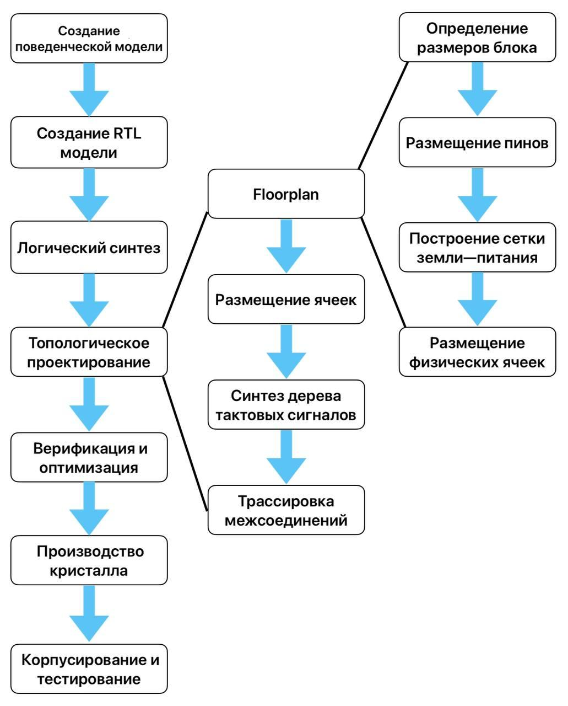
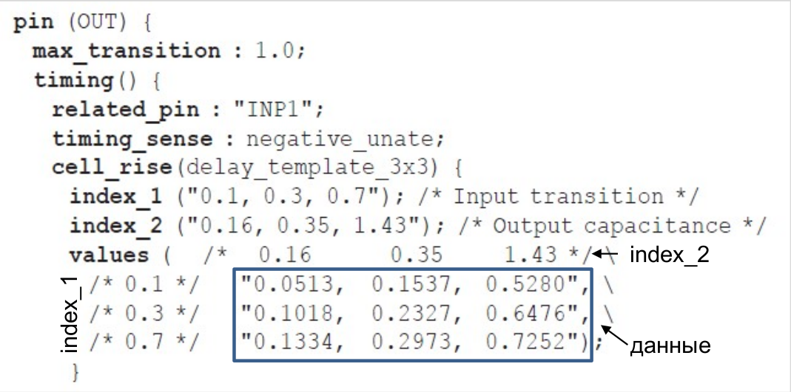
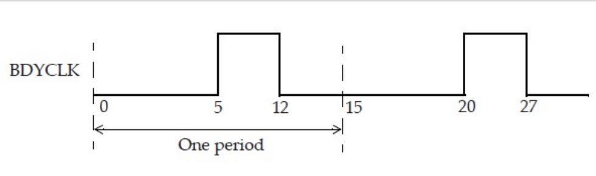

# Введение

## Цель работы

Цель работы – приобретение базовых навыков логического синтеза и топологического проектирования блоков цифровых схем с помощью САПР.

Для достижения цели работы предлагается пройти указанные этапы маршрута для простейшей схемы, представленной на языке описания аппаратуры с использованием реальной открытой библиотеки. 

Особенностью работы является использование САПР с открытым исходным кодом, что делает ее доступной для широкого круга обучающихся.

## Маршрут проектирования СБИС

При проектировании СБИС используется нисходящая модель маршрута проектирования. В такой организации маршрута проект проходит различные фазы, увеличивая детализацию представления. Основные этапы представлены в левой части рисунка ниже. Рассмотрим их подробнее.



**Создание поведенческой модели**

На первом этапе происходит проработка технических требований к разрабатываемой микросхеме, разработка общей архитектуры микросхемы, что может включать в себя: построение модели на языке высокого уровня, определение основных высокоуровневых блоков и связей между ними, распределение потоков данных между блоками, выбор внутренних и внешних шин, входных и выходных интерфейсов микросхемы, стратегий синхронизации и сброса.

**Создание RTL модели**

RTL (англ. Register Transfer Level - уровень регистровых передач) модель – это описание схемы, выполняемое с помощью языков описания аппаратуры. Оно включает в себя объявление регистров и описание комбинационной логики. Регистры (обычно реализованные с помощью D-триггеров) синхронизируют работу схем по фронтам синхросигнала. Элементы комбинационной логики выполняют логические функции и представляют собой логические вентили. На языке описания аппаратуры регистры аналогичны переменным в языках программирования компьютеров, а комбинационная логика описывается конструкциями типа «if-then-else» и арифметическими операциями. После создания RTL модели проводится ее функциональное тестирование. Для этого выполняется моделирование RTL с помощью специального тестового окружения. Также возможна реализация проекта на ПЛИС.

**Логический синтез**

На этапе синтеза происходит преобразование RTL модели в цепи из заранее спроектированных стандартных ячеек и макроблоков при помощи САПР с одновременной оптимизацией по быстродействию, размерам и потребляемой мощности. Логические элементы входят в состав библиотек стандартных ячеек, которые необходимо загрузить в САПР. Инструкцией по оптимизации служат файлы временных ограничений формата SDC.

В процессе синтеза можно выделить следующие этапы:

- Оптимизация логической функции;
- Реализация логической функции в базисе загруженных библиотек;
- Оптимизация критических путей;
- Внедрение тестовых структур (DFT - англ. Design For Test);
- Генерация списка межсоединений (англ. netlist);
- Проверка и вывод результатов.

В результате синтеза, САПР создает netlist - список межсоединений СБИС, преобразует информацию о временных ограничениях для этапа топологического проектирования, а также выводит результаты анализа быстродействия, оценку размеров, мощности и т.д. После синтеза с помощью специального САПР проводится проверка логической эквивалентности полученного нетлиста и исходного RTL.

**Топологическое проектирование**

Основной задачей топологического проектирования является размещение и трассировка элементов схемы на кристалле. Основные этапы топологического проектирования представлены на рисунке выше. Стадия создания floorplan на этапе верхнего уровня, т.е. для всего кристалла включает в себя:

- Определение размера кристалла;
- Размещение ячеек ввода-вывода;
- Размещение и трассировка бампов (в случае flip chip);
- Размещение макроблоков;
- Размещение физических ячеек (Well-Tap/End-Cap);
- Построение сетки земли-питания.

По ходу маршрута происходит оптимизация по быстродействию и потребляемой мощности. Для проверки удовлетворения временным ограничениям на каждом этапе проводится статический временной анализ (STA).

При топологическом проектировании больших проектов существует возможность разбивать их на блоки, топология которых разрабатывается по отдельности. Данный подход наиболее оправдан в случае, когда СБИС содержит несколько одинаковых блоков, либо данные блоки будут использоваться в других проектах. В таком случае можно добиться лучшей оптимизации проекта по быстродействию и сократить время разработки. Однако при этом возникают сложности при согласовании тактовых сигналов блоков и их систем питания. В рамках данной работы мы будем заниматься разработкой топологии именно отдельного блока. Маршрут разработки отдельного блока в основном повторяет маршрут разработки всей микросхемы. Наибольшее отличие касается элементов ввода-вывода. В состав блока не входят ячейки ввода-вывода, контактные площадки или бампы.

Для разрабатываемого в данной работе блока этап разработки floorplan состоит из шагов, отраженных на рисунке выше.

**Финальная верификация и оптимизация**

По завершении основных этапов топологического проектирования проводится финальная оптимизация временных параметров в специализированном САПР. Затем выполняется верификация проекта для того, чтобы убедиться, что разработанная топология удовлетворяет начальным требованиям, а также требованиям фабрики-изготовителя. Финальная верификация по каждому из критериев проводится, как правило, в специализированном САПР и включает в себя следующие этапы:

- Финальный статический временной анализ;
- Анализ потребляемой мощности;
- Анализ падения напряжения;
- Проверка электромиграции;
- DRC - проверка топологии на соответствие требованиям фабрики-изготовителя;
- LVS - проверка соответствия топологии финальному списку межсоединений;
- ERC - проверка на наличие нарушений электрических характеристик.

## Задачи

В процессе выполнения работы необходимо выполнить следующие основные задачи:

- Ознакомиться с вводной информацией о проекте (структура директорий, verilog описание);
- Синтезировать список межсоединений (netlist);
- Оценить размер топологии блока на основе результатов синтеза;
- Разработать floorplan блока;
- Выполнить размещение стандартных ячеек, синтез дерева тактовых сигналов, трассировку межсоединений;
- Оценить основные характеристики разработанной топологии;
- Выписать финальный GDS файл.

Помимо этого работа включает дополнительные задания, направленные на ознакомление со структурой входных и выходных данных.

## Используемые данные

В маршруте проектирования СБИС помимо последовательности этапов важную роль играют входные и выходные данные для каждого этапа. В рамках данной работы мы будем использовать ограниченный набор данных. В первую очередь это LIB, LEF, TechLEF, DEF и GDS файлы. С этими файлами будет связано несколько практических заданий.

- LEF файл содержит базовую геометрическую информацию о ячейках, такую как геометрические размеры, расположение пинов;
- TechLEF - технологический LEF файл. Содержит общую информацию о техпроцессе, значимую для топологического САПР. Он содержит такую информацию, как шаг расположения стандартных ячеек, максимальная толщина металла в каждом слое, характеризацию переходных отверстий и т.д.;
- DEF файл используется для хранения информации о взаимном расположении элементов и межсоединений блока. В данной работе DEF файлы будут использоваться для хранения данных после прохождения каждого этапа разработки топологии;
- GDS - это бинарный файл, который содержит полное описание топологии ячейки/блока/кристалла в виде полигонов.

Помимо этого в работе будут использоваться LIB и SDC файлы.

LIB файлы представляют информацию о задержках элементов в виде таблиц с небольшим количеством значений. Для каждого конкретного входного значения САПР выполняет аппроксимацию на основе данных таблицы. Пример таблицы приведен на рисунке ниже.



Описываемые в LIB характеристики зависят от внешних условий. Чтобы учесть эти зависимости разработчики библиотек создают несколько наборов LIB файлов, в зависимости от таких параметров, как температура, напряжение, вариации технологического процесса.

Файлы SDC позволяют описать ограничения на временные характеристики микросхемы. В соответствии с ними происходит оптимизация соответствующих параметров микросхемы. Статический временной анализ (STA) позволяет проверить соответствие микросхемы описанным ограничениям. В случае отсутствия нарушений можно говорить о достижении заданного быстродействия. Одним из самых важных элементов SDC является объявление тактового сигнала. Рассмотрим простейший тактовый сигнал (см. рисунок ниже):



Он следующим образом описывается в SDC файле:

```tcl
create_clock -name BDYCLK -period 15 -waveform {5 12} [get_ports GBLCLK]
```

## Используемое ПО

Для выполнения работы необходимы следующие САПР:

- Yosys - для логического синтеза;
- OpenROAD - для разработки топологии;
- Magic - для генерации финального GDS;
- KLayout - для просмотра GDS и LEF файлов.

В данной работе мы будем использовать САПР, входящие в OpenLane/LibreLane, по отдельности. Это позволит более подробно изучить маршрут и подготовиться к работе с более сложными проектами. Далее перейдем к [подготовке](intro.md).
